# ShopNest — Automated CI/CD Pipeline for a Three-Tier Web Application

> **DevOps Assignment:** GitHub Actions Fundamentals and Three-Tier App Deployment Automation
> **Repository:** https://github.com/Faruque5698/shopnest-cicd-pipeline

## Live Application URLs

| Environment | Live URL | Deployment Trigger | Database |
| :--- | :--- | :--- | :--- |
| **Production** | http://13.211.135.238 | Automatic after CI + Staging + **Manual Approval** | Private AWS RDS (`shopnest_prod`) |
| **Staging** | http://13.211.135.238:8080 | Automatic after CI succeeds on `main` | Private AWS RDS (`shopnest_staging`) |
| **Health Endpoint** | http://13.211.135.238/api/health | Live health, DB status, active Blue/Green slot & commit SHA | Verified via `SELECT 1` |
| **Version Endpoint** | http://13.211.135.238/api/version | Exact deployed Git commit traceability | — |

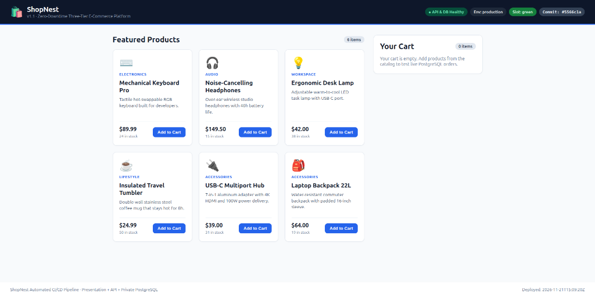

---

## Table of Contents

1. [Project Overview & Three-Tier Architecture](#1-project-overview--three-tier-architecture)
2. [Part A: CI/CD Concepts for ShopNest Management](#2-part-a-cicd-concepts-for-shopnest-management)
3. [Part B: Continuous Integration Pipeline & Branch Protection](#3-part-b-continuous-integration-pipeline--branch-protection)
4. [Part C: Workflow Architecture & Diagrams](#4-part-c-workflow-architecture--diagrams)
5. [Part D: Secrets and Configuration Management](#5-part-d-secrets-and-configuration-management)
6. [Part E: Automated Deployment to AWS EC2 & Private RDS](#6-part-e-automated-deployment-to-aws-ec2--private-rds)
7. [Part F: Zero-Downtime Deployment Strategy & Proof](#7-part-f-zero-downtime-deployment-strategy--proof)
8. [Part G: Monitoring, Health Checks & Rollback](#8-part-g-monitoring-health-checks--rollback)
9. [Part H: Debugging & GitHub Copilot-Assisted Development](#9-part-h-debugging--github-copilot-assisted-development)
10. [Part I: Repository Structure & Reproducible Setup Guide](#10-part-i-repository-structure--reproducible-setup-guide)

---

## 1. Project Overview & Three-Tier Architecture

**ShopNest** is a three-tier e-commerce web application replacing manual SSH deployments with a secure, automated, zero-downtime GitHub Actions CI/CD pipeline deployed to AWS:

- **Presentation Tier (`frontend/`):** React + Vite single-page e-commerce storefront (catalog, shopping cart, live order checkout, live environment/slot/commit status badges) served statically by **Nginx**.
- **Application Tier (`backend/`):** Node.js + Express REST API (`/api/health`, `/api/version`, `/api/products`, `/api/orders`) managed by **PM2** across isolated Blue/Green ports (`127.0.0.1:4001` & `4002` in Production; `5001` & `5002` in Staging), with graceful `SIGTERM`/`SIGINT` connection draining.
- **Data Tier (`database/`):** Managed **AWS RDS PostgreSQL** placed inside **Private Subnets** of a custom VPC (`10.0.0.0/16`) with `Public access: No` and Security Group chaining (`shopnest-db-sg` accepts TCP `5432` **only** from `shopnest-app-sg`), making the database completely unreachable from the public internet.

### AWS Three-Tier Infrastructure Diagram

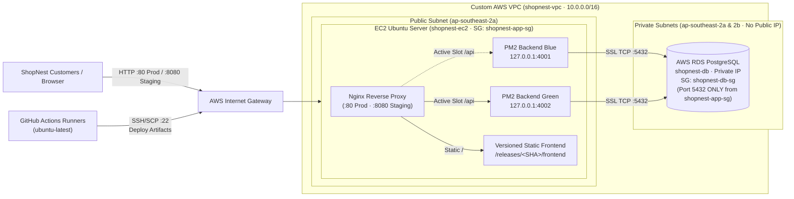

---

## 2. Part A: CI/CD Concepts for ShopNest Management

### CI vs. Continuous Delivery vs. Continuous Deployment

| Practice | What Happens Automatically | What Remains Manual | Primary Goal |
| :--- | :--- | :--- | :--- |
| **Continuous Integration (CI)** | Every push or Pull Request installs dependencies, runs linters, executes automated tests, builds artifacts, and verifies output integrity. | Merging approved PRs and releasing to servers. | Catch bugs early and keep `main` always buildable and tested. |
| **Continuous Delivery** | Everything in CI **plus** automated packaging and deployment to Staging, keeping every verified commit ready to release to Production at any moment. | A **human approval gate** (one click) triggers the actual Production rollout. | Ship safely and rapidly while preserving business/engineering sign-off before customer impact. |
| **Continuous Deployment** | Everything in Continuous Delivery **plus** automatic deployment straight to Production after CI/staging checks pass—with zero human intervention. | None (every green commit goes straight to users). | Maximum release velocity for mature teams with exhaustive automated test suites. |

### How This Pipeline Solves ShopNest's Three Incidents

1. **Incident 1 — Broken build reached production because nobody ran tests:**
   - Every Pull Request against `main` automatically runs [ci.yml](.github/workflows/ci.yml) across both Frontend and Backend (install, ESLint, 15 automated unit/API tests across Node.js 20 & 22, production builds, and artifact verification).
   - **Branch Protection** on `main` strictly blocks merging (even for administrators) until all 5 CI status checks pass.
2. **Incident 2 — 10 minutes of site downtime during every deployment:**
   - Replaced manual in-place `git pull` + restart with **Blue-Green Zero-Downtime Deployment** ([deploy-blue-green.sh](scripts/deploy-blue-green.sh)).
   - The new release starts and passes health checks in an idle slot (`blue` or `green`) while live users remain unaffected; **Nginx** switches traffic atomically via `nginx -s reload`, reducing deployment downtime from ~10 minutes to **0 seconds (100% availability)**.
3. **Incident 3 — 2-hour outage after a bad release because nobody knew the last good version:**
   - Every release is versioned by its exact **Git Commit SHA**, exposed at `/api/health` and `/api/version`, archived in `/var/www/shopnest/*/releases/<SHA>/`, and recorded in `releases_history.log` and `last_good_sha`.
   - Automated health checks catch unhealthy releases and **automatically roll back in seconds** without impacting live users, and [rollback.yml](.github/workflows/rollback.yml) provides a one-click **Manual Rollback** to any historical commit SHA.
4. **Bonus — Eliminated Committed Secrets (CTO Security Finding):**
   - Zero credentials, passwords, SSH keys, or database endpoints exist anywhere in the repository or commit history. A dedicated parallel `security-hygiene` CI job guards every PR against accidental `.env` or `.pem` commits.

### Chosen Approach for ShopNest: **Continuous Delivery**

We chose **Continuous Delivery** (automated CI + automated Staging deployment + **Manual Approval gate for Production**):
- As a growing e-commerce startup handling live customer orders, ShopNest benefits from automated verification in an identical Staging environment (`:8080`) before an engineer signs off on Production (`:80`).
- Continuous Delivery directly enforces ShopNest's compliance policy (*"Deployments to production must require manual approval"*) while keeping releases fast (~25 seconds after approval), repeatable, and zero-downtime.

---

## 3. Part B: Continuous Integration Pipeline & Branch Protection

Workflow file: [`.github/workflows/ci.yml`](.github/workflows/ci.yml)

- **Triggers:** Automatically runs on every `push` to `main` and every `pull_request` targeting `main`.
- **Concurrency:** Automatically cancels superseded PR runs (`cancel-in-progress: ${{ github.event_name == 'pull_request' }}`) without ever cancelling `main` runs.
- **Backend CI (`backend/`):**
  - Matrix tested on **Node.js 20** and **Node.js 22** (`fail-fast: false`).
  - Steps: `npm ci` → `npm run lint` (ESLint) → `npm test` (**9 Vitest + Supertest tests** covering `/api/health` 200 & 503, `/api/version`, product CRUD validation, order total/tax calculations) → `npm run build` (packages production files + commit-stamped `build-info.json` into `backend/dist/`).
- **Frontend CI (`frontend/`):**
  - Runs in **parallel** with Backend CI on Node.js 20.
  - Steps: `npm ci` → `npm run lint` (ESLint + React Hooks) → `npm test` (**6 Vitest + React Testing Library tests** covering cart math, currency formatting, storefront rendering, health badges, and Add-to-Cart interactions) → `npm run build` (Vite production bundle in `frontend/dist/`).
- **Security Hygiene Check (`security-hygiene`):**
  - Runs in **parallel** to verify no `.env`, `.pem`, `.key`, or SSH private key files are tracked by Git.
- **Artifact Verification (`verify`):**
  - Depends on `[security-hygiene, backend, frontend]`; downloads all 3 uploaded build artifacts (`backend-build-node-20`, `backend-build-node-22`, `frontend-build`) and verifies file integrity and exact `GITHUB_SHA` match inside `build-info.json`.
- **Branch Protection (`main`):**
  - Requires Pull Requests (no direct pushes to `main`), requires all 5 CI status checks (`Security Hygiene Check`, `Backend CI (Node.js 20)`, `Backend CI (Node.js 22)`, `Frontend CI (Node.js 20)`, `Verify Build Artifacts`), and enforces rules for administrators (`enforce_admins: true`).

| Passing CI Pipeline Graph & Artifacts | `main` Branch Protection Rule |
| :---: | :---: |
| 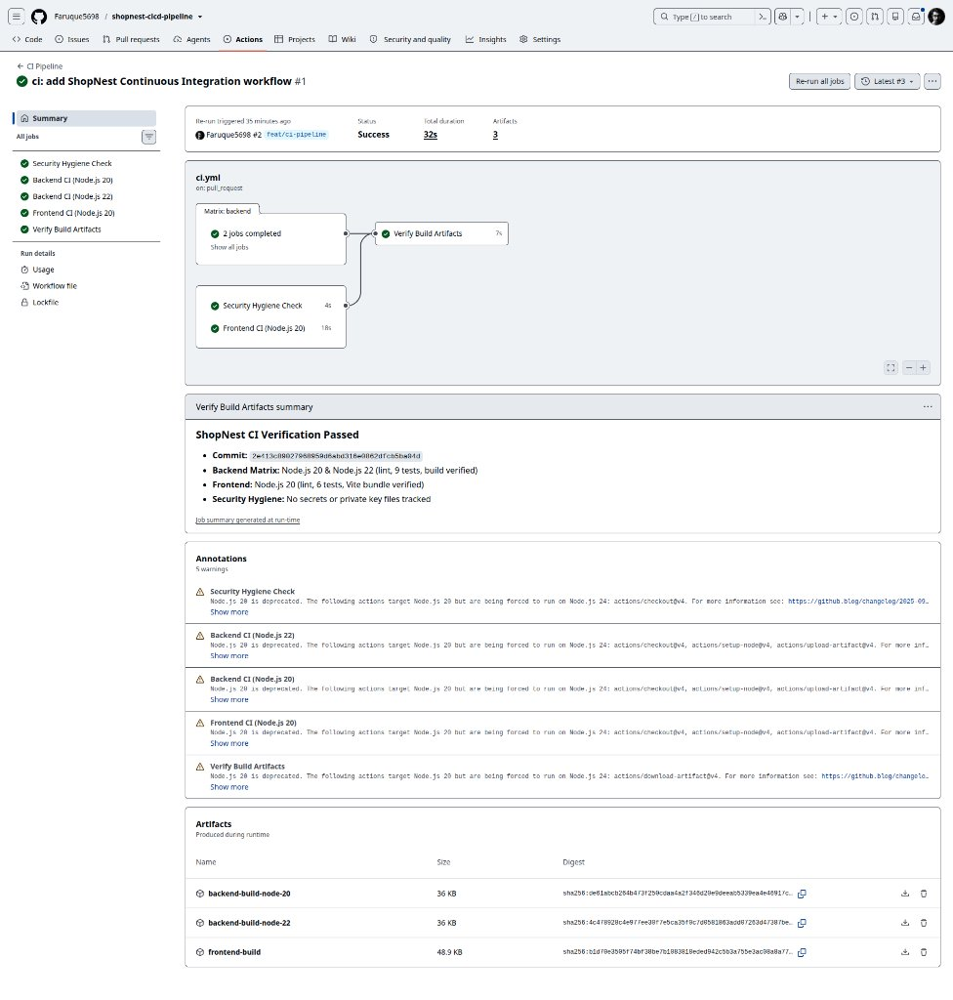 | 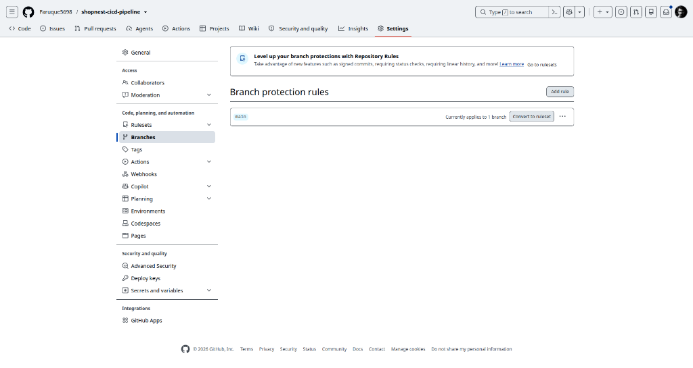 |

---

## 4. Part C: Workflow Architecture & Diagrams

Our pipeline cleanly separates responsibilities into **three dedicated workflows** running on GitHub-hosted **`ubuntu-latest`** runners:

1. **CI Workflow** ([`.github/workflows/ci.yml`](.github/workflows/ci.yml)) — Automated quality gate on pushes and PRs.
2. **CD Workflow** ([`.github/workflows/cd.yml`](.github/workflows/cd.yml)) — Triggered via `workflow_run` **only when `CI Pipeline` completes with `success` on `main`**.
3. **Manual Rollback Workflow** ([`.github/workflows/rollback.yml`](.github/workflows/rollback.yml)) — Triggered on demand via `workflow_dispatch` to restore any earlier Git commit SHA.

### Complete CI/CD Workflow, Jobs, Steps & Runners Diagram

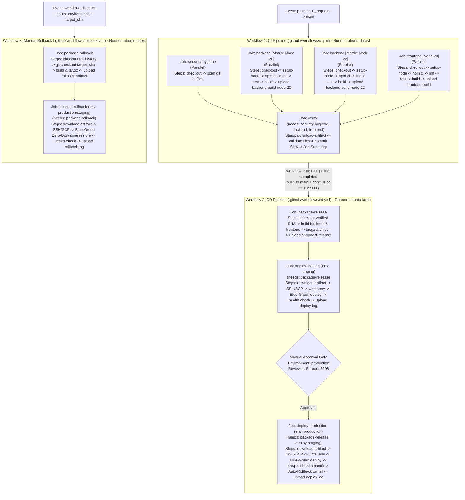

---

## 5. Part D: Secrets and Configuration Management

- **Zero Secrets in Repository:** No passwords, SSH keys, database hostnames, or `.env` files exist anywhere in the codebase or commit history (verified via `git log -p` audit and enforced by `.gitignore` + CI `security-hygiene` job).
- **Environment Isolation:** Configuration is strictly separated across two GitHub Environments (`staging` and `production`), each injecting its own runtime `.env` securely over SSH with `umask 077` (`chmod 600`) and masked GitHub Actions logs (`***`).
- **Manual Approval Gate:** The `production` environment enforces **Required reviewers (`Faruque5698`)**, pausing every production deployment and production rollback until explicitly reviewed and approved.

### Secrets Inventory (Values Never Stored in Repo)

| Secret Name | Scope | Purpose |
| :--- | :--- | :--- |
| `EC2_HOST` | Environment (`staging`, `production`) | Target EC2 server address for SSH/SCP deployments. |
| `EC2_USER` | Environment (`staging`, `production`) | SSH login username on the EC2 host (`ubuntu`). |
| `EC2_SSH_KEY` | Environment (`staging`, `production`) | Private PEM key used exclusively during workflow execution (`chmod 600`) to authenticate SSH/SCP. |
| `DB_HOST` | Environment (`staging`, `production`) | Private AWS RDS PostgreSQL endpoint (unreachable from public internet). |
| `DB_USER` | Environment (`staging`, `production`) | PostgreSQL database username for migrations and API queries. |
| `DB_PASSWORD` | Environment (`staging`, `production`) | PostgreSQL database password injected securely into server `.env` (never echoed to logs). |

### Environment Variables Inventory (Non-Sensitive Config)

| Variable Name | Staging Value | Production Value | Purpose |
| :--- | :--- | :--- | :--- |
| `APP_ENV` | `staging` | `production` | Runtime environment label exposed by `/api/health` and UI badges. |
| `DB_NAME` | `shopnest_staging` | `shopnest_prod` | Isolated PostgreSQL database name per environment. |
| `DB_PORT` | `5432` | `5432` | PostgreSQL TCP port. |
| `DB_SSL` | `true` | `true` | Enables encrypted TLS/SSL connections to AWS RDS PostgreSQL. |
| `DEPLOY_ROOT` | `/var/www/shopnest/staging` | `/var/www/shopnest/prod` | Base directory on EC2 storing versioned releases, `.env`, and logs. |
| `NGINX_SLOT_FILE` | `/var/www/shopnest/nginx/staging-slot.inc` | `/var/www/shopnest/nginx/prod-slot.inc` | Atomic Nginx slot configuration file switched during Blue-Green cutover. |
| `BLUE_PORT` | `5001` | `4001` | Localhost backend port for the `blue` slot. |
| `GREEN_PORT` | `5002` | `4002` | Localhost backend port for the `green` slot. |
| `PUBLIC_PORT` | `8080` | `80` | Public Nginx HTTP listener port for each environment. |

| Staging Environment Config | Production Environment + Manual Approval Rule |
| :---: | :---: |
| 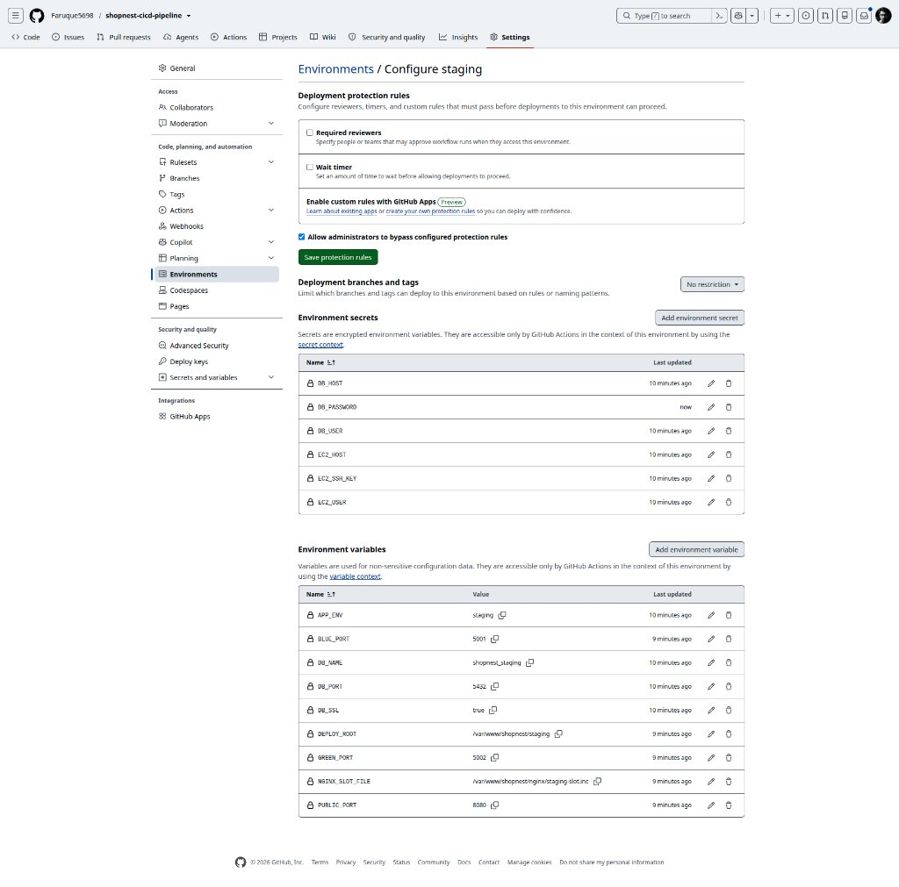 | 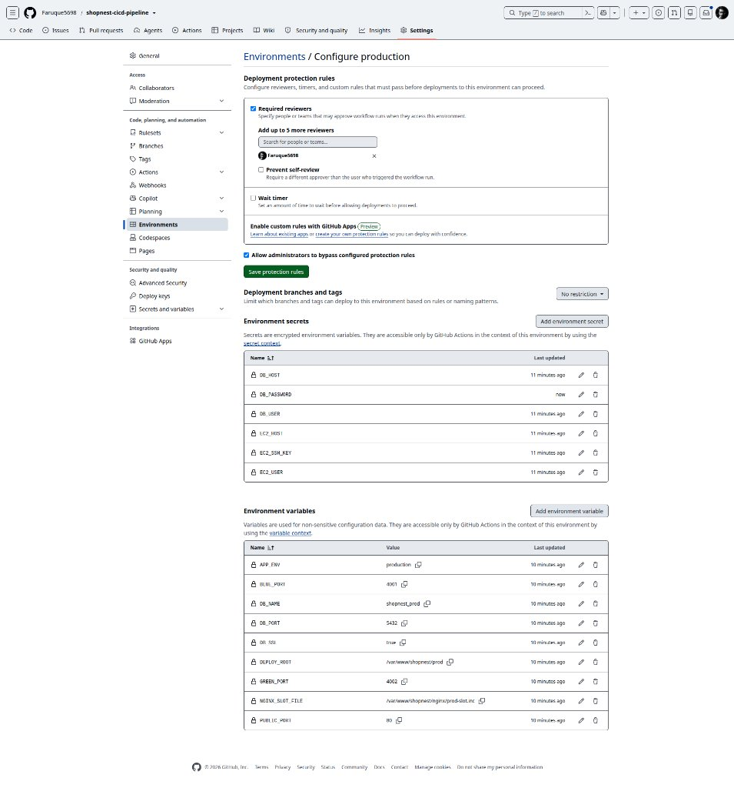 |

| Manual Approval Gate (Paused Run) | Production Review & Approve Dialog |
| :---: | :---: |
| 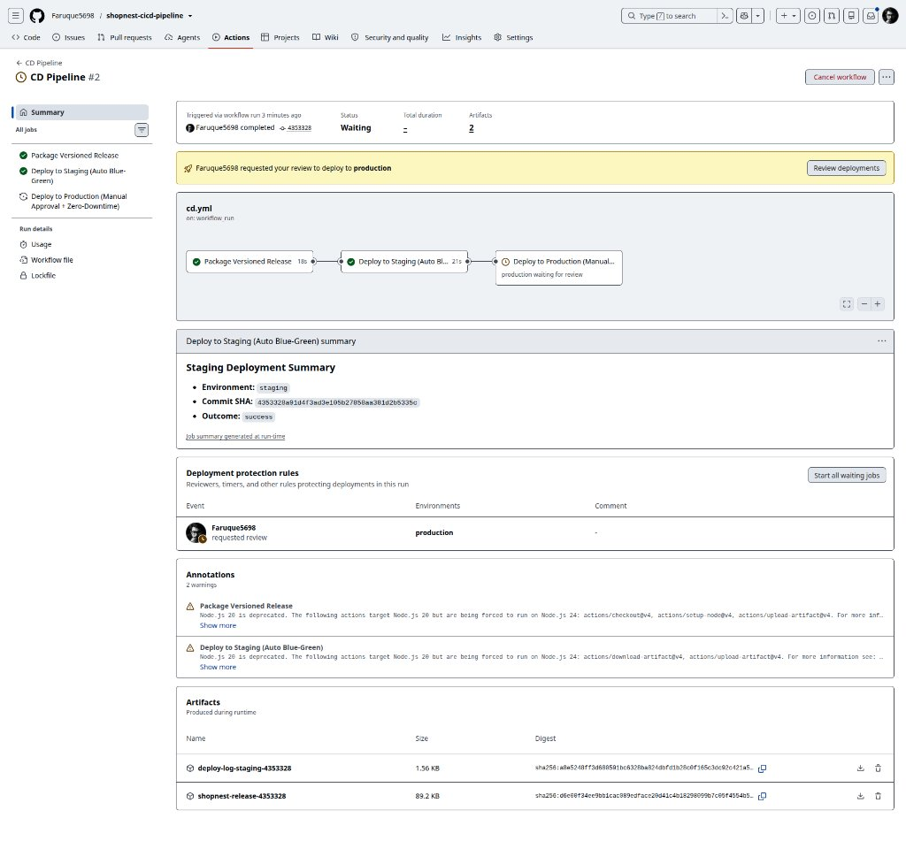 | 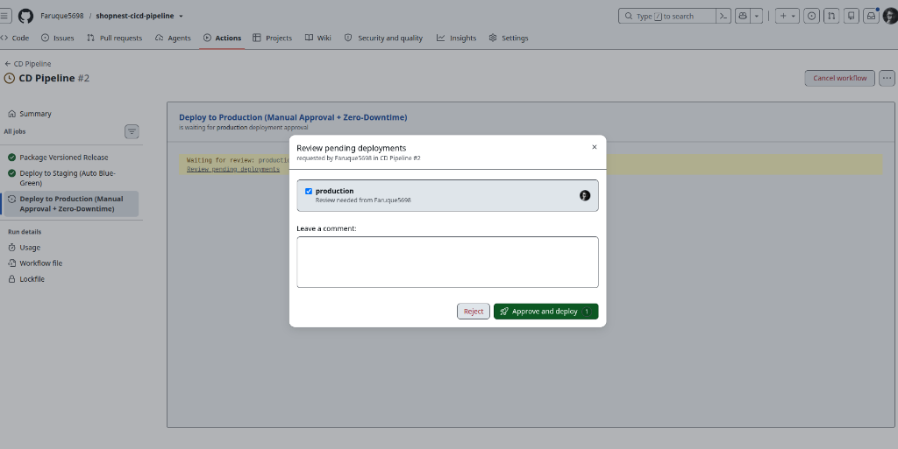 |

---

## 6. Part E: Automated Deployment to AWS EC2 & Private RDS

### Cloud Network & Private Database Security
- **Custom VPC (`shopnest-vpc`, `10.0.0.0/16`):** 2 Public Subnets + 2 Private Subnets across `ap-southeast-2a` and `ap-southeast-2b`.
- **EC2 Application Server (`shopnest-ec2`):** Placed in Public Subnet (`shopnest-subnet-public1-ap-southeast-2a`) attached to `shopnest-app-sg` (allowing only TCP `22`, `80`, `8080`). Internal backend ports (`4001`, `4002`, `5001`, `5002`) bind exclusively to `127.0.0.1`.
- **Private RDS PostgreSQL (`shopnest-db`):** Placed in `shopnest-private-db-subnets` (Private Subnets only), **`Public access: No`**, attached to `shopnest-db-sg` which allows TCP `5432` **exclusively from `shopnest-app-sg`** via Security Group chaining.

#### Proof: Private Database Unreachable from Public Internet
```text
# Tested from external developer machine (outside VPC):
$ nc -zv -w 3 <RDS_ENDPOINT> 5432
nc: connect to <RDS_ENDPOINT> (10.0.129.193) port 5432 (tcp) timed out: Operation now in progress
LOCAL BLOCKED (GOOD!)

# Tested from inside shopnest-ec2 (inside VPC with shopnest-app-sg):
$ PGSSLMODE=require psql -h <RDS_ENDPOINT> -p 5432 -U shopnest_admin -d shopnest_prod -c "\l"
 shopnest_prod    | shopnest_admin | UTF8
 shopnest_staging | shopnest_admin | UTF8
```

### Commit Traceability
Every deployment is traceable to the exact Git commit SHA across 5 layers:
1. Live API `/api/health` and `/api/version` JSON (`"commit"`, `"shortCommit"`, `"slot"`, `"deployedAt"`).
2. Frontend storefront header badges (`Slot: green | Commit: #d837d69`).
3. EC2 release directories (`/var/www/shopnest/prod/releases/<40-char-SHA>/`) and `build-info.json`.
4. Persistent EC2 logs (`/var/www/shopnest/prod/logs/deployments.log` and `releases_history.log`).
5. GitHub Actions Job Summaries and uploaded 30-day deployment log artifacts.

| Custom VPC Architecture | Security Group Chaining (`shopnest-db-sg`) |
| :---: | :---: |
| 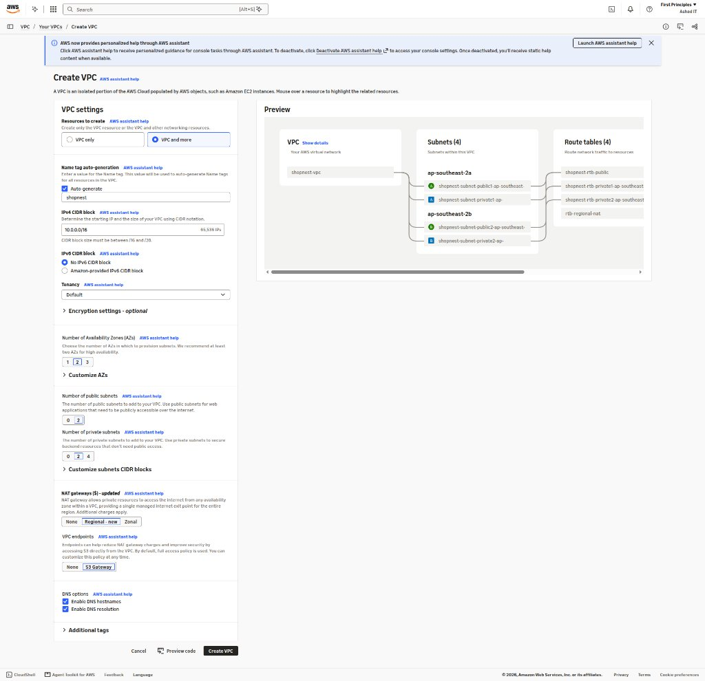 | 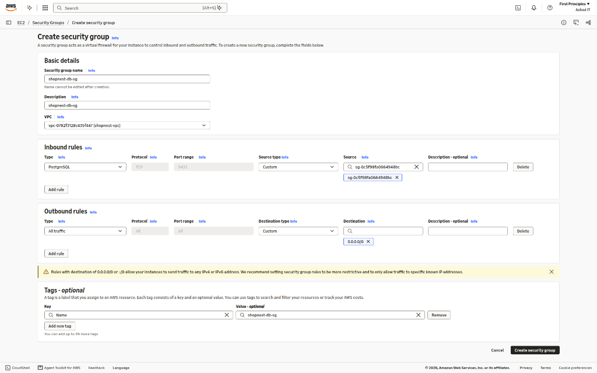 |

| Private DB Subnet Group | Full Automated CD Pipeline Success |
| :---: | :---: |
| 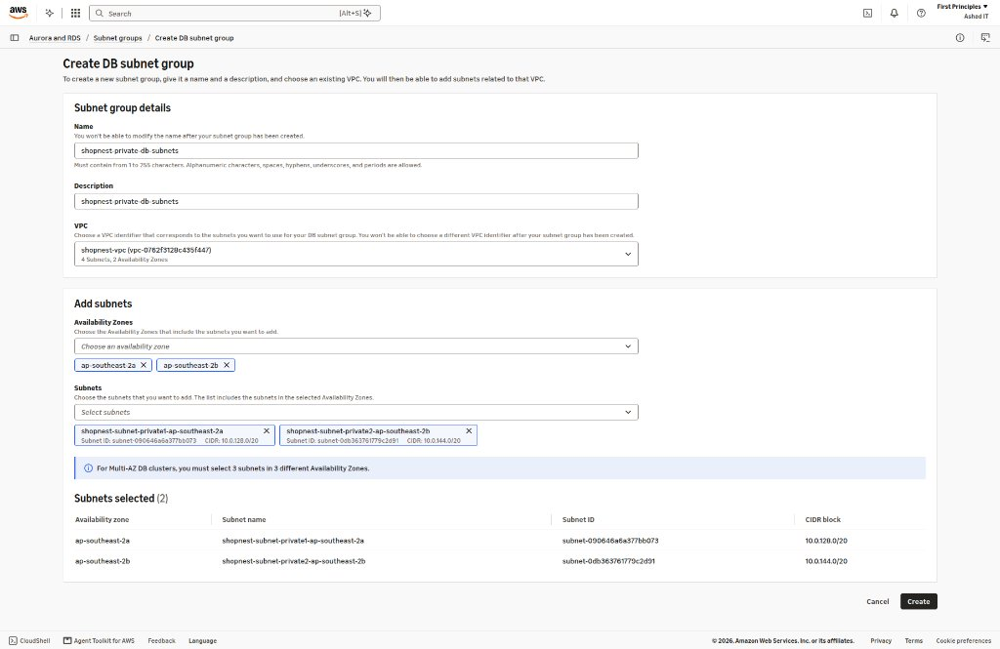 | 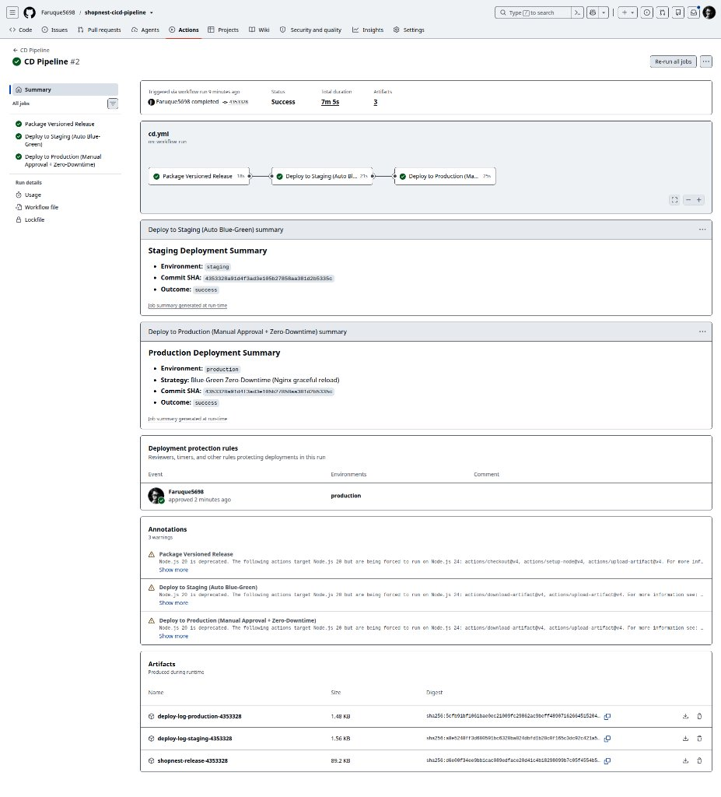 |

---

## 7. Part F: Zero-Downtime Deployment Strategy & Proof

### Chosen Strategy: **Blue-Green Deployment with Nginx Graceful Reload**

Production maintains two isolated backend slots managed by PM2 (**Blue** on `127.0.0.1:4001` and **Green** on `127.0.0.1:4002`) alongside immutable commit-versioned frontend directories (`/var/www/shopnest/prod/releases/<SHA>/frontend`).

During every deployment ([`scripts/deploy-blue-green.sh`](scripts/deploy-blue-green.sh)):
1. Detect currently live slot (e.g., `blue`) and select the idle slot (`green`).
2. Extract the verified release artifact, install production dependencies, apply idempotent SQL migrations, and boot the candidate API on the **idle** port (`4002`) — active traffic on `blue` (`4001`) is completely untouched.
3. Run **Pre-Switch Health Check** (`http://127.0.0.1:4002/api/health`) verifying HTTP `200`, `database: "connected"`, and exact target commit SHA.
4. Atomically replace `/var/www/shopnest/nginx/prod-slot.inc` (`mv .tmp -> .inc`), validate syntax (`sudo nginx -t`), and issue a graceful reload (`sudo nginx -s reload`) — Nginx drains existing requests on old workers while immediately routing new requests to `green`.
5. Run **Post-Switch Public Verification** through Nginx on port `80` (`/` + `/api/health`).
6. Wait 3 seconds for in-flight requests to drain cleanly via graceful `SIGTERM` handling in [`backend/src/server.js`](backend/src/server.js), then stop the old `blue` process.

### Trade-offs of Blue-Green Deployment

| Advantage | Trade-off / Mitigation |
| :--- | :--- |
| **True 0ms downtime** during cutover and rollback. | **Temporarily doubles application RAM/CPU** while both Blue and Green run during cutover (mitigated on `t3.micro` with 1GB swap and stopping the old slot right after draining). |
| **Pre-production live smoke test** on the real host before any customer sees the release. | **Shared relational database requires backward-compatible schema migrations** (expand-and-contract pattern; our `schema.sql` uses idempotent `CREATE TABLE IF NOT EXISTS`). |
| **Instantaneous rollback** since the previous slot stays untouched until cutover succeeds. | Slightly more Nginx/PM2 orchestration logic than a simple Recreate deploy (cleanly encapsulated in a single reusable bash script). |

### Zero-Downtime Proof (Live Cutover During Continuous Traffic)

We executed [`scripts/zero-downtime-test.sh`](scripts/zero-downtime-test.sh) polling **both** `/api/health` (API + DB) and `/` (Frontend UI) continuously every 0.35s while approving and executing Production CD Run [`#44920153269`](https://github.com/Faruque5698/shopnest-cicd-pipeline/actions/runs/44920153269) (`v1.2.0`, switching live from **`blue@d837d69`** → **`green@d837d69`**). Full sanitized log: [`docs/zero-downtime-evidence.txt`](docs/zero-downtime-evidence.txt).

```text
==================================================================
ShopNest Continuous Zero-Downtime Verification
Target URL : <PRODUCTION_LIVE_URL>
Duration   : 60s (polling every 0.35s)
Started At : 2026-11-21T15:38:06Z
==================================================================
[15:38:06] #1  HTTP 200 (API) / 200 (UI)  --> LIVE VERSION TRANSITION: initial -> blue@d837d69
[15:38:16] >>> PRODUCTION DEPLOYMENT APPROVED LIVE MID-TRAFFIC <<<
[15:38:31] #15  HTTP 200 (API) / 200 (UI)  | Active: blue@d837d69 | Failed: 0
[15:38:35] #18  HTTP 200 (API) / 200 (UI)  --> LIVE VERSION TRANSITION: blue@d837d69 -> green@d837d69
[15:38:56] #30  HTTP 200 (API) / 200 (UI)  | Active: green@d837d69 | Failed: 0
==================================================================
Zero-Downtime Verification Summary
Total Requests : 35
Succeeded (200): 35
Failed         : 0
Availability   : 100.00%
Final Active   : green@d837d69
==================================================================
```

| Before Switch (`Slot: blue`) | After Zero-Downtime Switch (`Slot: green`) |
| :---: | :---: |
|  |  |

---

## 8. Part G: Monitoring, Health Checks & Rollback

### 1. Automated Health Checks & Automatic Rollback Demonstration
- Every deployment executes a **15-attempt Pre-Switch Health Check** on the candidate slot AND an **8-attempt Post-Switch Health Check** on the public Nginx port (verifying HTTP `200`, `status === "healthy"`, `database === "connected"`, exact `commit === GITHUB_SHA`, and frontend HTML rendering).
- **Live Demonstration:** In [PR #7](https://github.com/Faruque5698/shopnest-cicd-pipeline/pull/7) (commit [`f1653f4`](https://github.com/Faruque5698/shopnest-cicd-pipeline/commit/f1653f4)), we deployed a deliberately broken production release (`20ba258`) where `/api/health` returned HTTP `503` in production (while passing unit tests and staging).
- During Production CD Run [`#44919456119`](https://github.com/Faruque5698/shopnest-cicd-pipeline/actions/runs/44919456119), the health check failed on the idle `blue` slot, **automatically stopped and cleaned up the broken release**, verified that live traffic stayed uninterrupted on the last known good release **`5566c1a` (`slot: green`)**, and persisted full rollback logs both on EC2 and as GitHub Actions artifact `deploy-log-production-20ba258`:

```text
[2026-11-21T15:31:04Z] [production] ERROR: Pre-Switch Health Check FAILED for commit 20ba258d878c7fe3ee3d71edc3ccf76ffe5828d3 on slot blue!
[2026-11-21T15:31:04Z] [production] --- Initiating AUTOMATIC ROLLBACK ---
[2026-11-21T15:31:05Z] [production] Health check PASSED on attempt 1/5 (http://127.0.0.1:80/api/health -> status=healthy, db=connected, commit=5566c1a)
[2026-11-21T15:31:05Z] [production] AUTOMATIC ROLLBACK SUCCESSFUL: Live traffic remained uninterrupted on last known good release 5566c1a69125481a8dcf83516444ef154b0e8755 (slot: green).
```

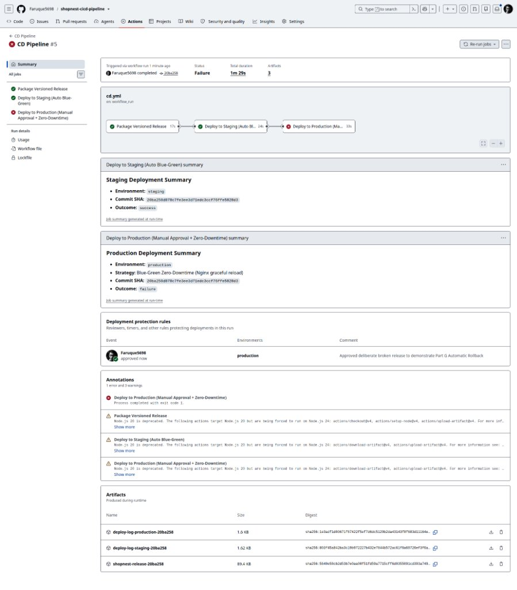

### 2. Manual Rollback to Any Earlier Version
- Workflow: [`.github/workflows/rollback.yml`](.github/workflows/rollback.yml) (`workflow_dispatch`)
- Navigate to **Actions → Manual Rollback → Run workflow**, choose `environment` (`production` or `staging`), and enter any earlier Git commit SHA.
- **Live Verification:** Run [`#44918292426`](https://github.com/Faruque5698/shopnest-cicd-pipeline/actions/runs/44918292426) rolled Production cleanly back from `v1.1.0` (`green@5566c1a`) to `v1.0.0` (`blue@4353328`) with zero downtime, uploading `rollback-log-production-4353328`.

| Manual Rollback Workflow Success | Live Production Restored to `#4353328` |
| :---: | :---: |
| 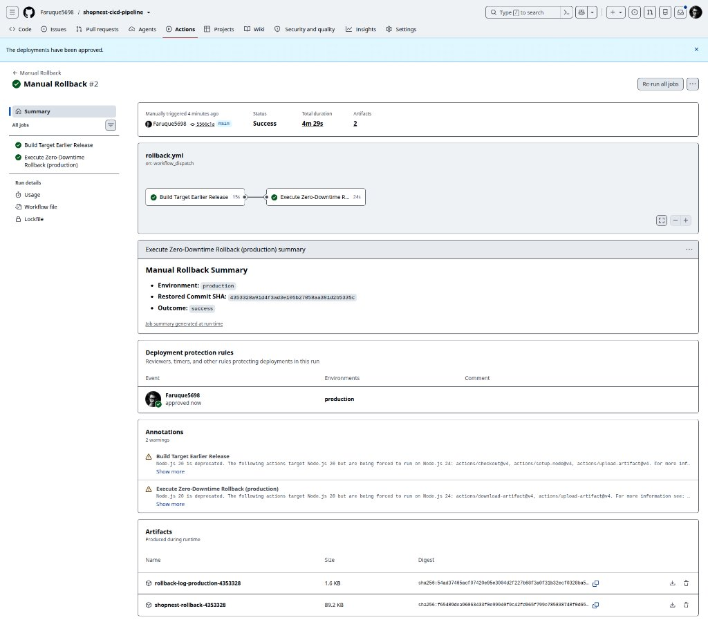 | 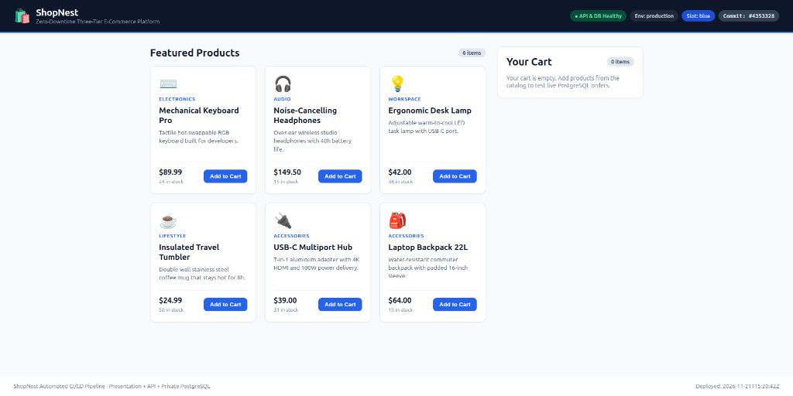 |

### 3. Persistent Deployment Logs
- **On EC2:** Timestamped logs per release at `/var/www/shopnest/{prod,staging}/logs/deploy-<timestamp>-<short-sha>.log`, plus cumulative audit trails in `deployments.log` and `releases_history.log`.
- **On GitHub Actions:** Every deployment and rollback uploads its full log artifact (`retention-days: 30`) and publishes a structured Markdown Job Summary.

---

## 9. Part H: Debugging & GitHub Copilot-Assisted Development

### Generating `.github/workflows/ci.yml` with GitHub Copilot

**Exact Prompt Used in GitHub Copilot:**
> `Create a GitHub Actions CI workflow file (.github/workflows/ci.yml) for a Node.js monorepo with backend/ and frontend/ directories. Trigger on push and pull_request to main. Run backend lint, test, and build across Node 20 and 22 using a matrix strategy, and run frontend lint, test, and build in parallel. Pass the build artifacts to a final verification job.`

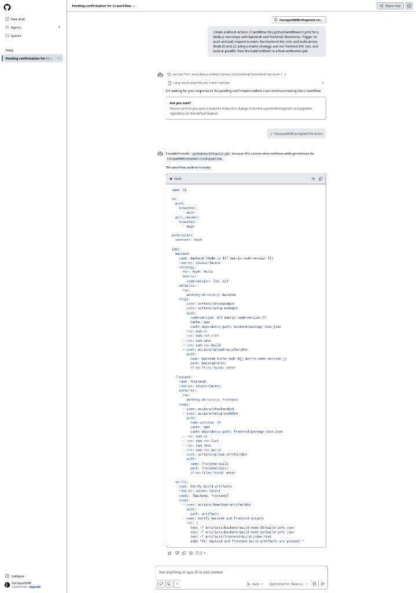

**What We Changed in Copilot's Output and Why:**
1. **Workflow Name (`CI` → `CI Pipeline`):** Standardized the exact workflow name so `cd.yml`'s `workflow_run` trigger can reliably bind to `"CI Pipeline"`.
2. **Added `concurrency` cancellation for PRs:** Copilot omitted `concurrency`; adding `cancel-in-progress: ${{ github.event_name == 'pull_request' }}` saves runner minutes on rapid PR updates while never cancelling `main` push runs.
3. **Added parallel `security-hygiene` job:** Prevents any `.env`, `.pem`, `.key`, or private SSH key from ever being committed (addressing the CTO's incident).
4. **Added `retention-days: 7` on CI artifacts:** Avoids keeping temporary CI build outputs for GitHub's default 90-day retention period.
5. **Injected `GIT_COMMIT_SHA: ${{ github.sha }}` and asserted SHA match in `verify`:** Copilot only checked file existence (`test -f build-info.json`); we enhanced `verify` to parse `build-info.json` and assert `commitSha === GITHUB_SHA` plus verify `src/server.js` and frontend `assets/`.
6. **Added explicit step `name:` labels and `$GITHUB_STEP_SUMMARY`:** Replaced unnamed `- run:` steps with human-readable labels and a Markdown CI summary for easier team review.

---

### Three Documented Pipeline Failures & Copilot-Assisted Troubleshooting

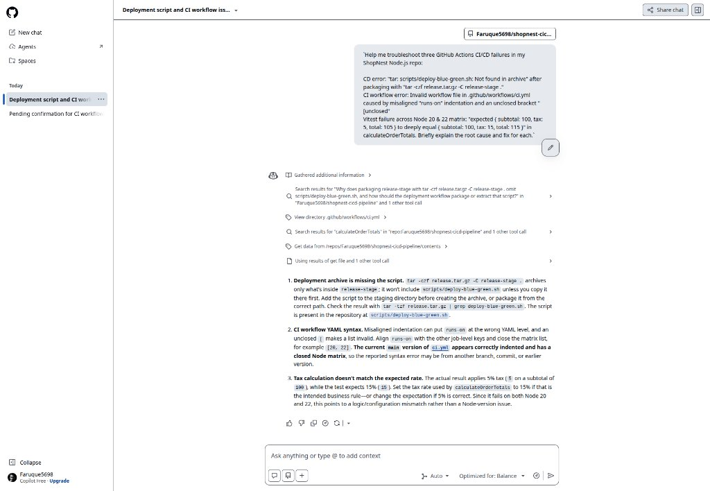

#### Failure #1: Deployment Archive Path Error (`CD Pipeline`)
- **Failed Run:** [CD Pipeline #1 (`#44915783300`)](https://github.com/Faruque5698/shopnest-cicd-pipeline/actions/runs/44915783300)
- **Error Observed:**
  ```text
  tar: scripts/deploy-blue-green.sh: Not found in archive
  tar: Exiting with failure status due to previous errors
  Process completed with exit code 2.
  ```
- **Root Cause & Copilot Troubleshooting:** Packaging with `tar -czf release.tar.gz -C release-stage .` prefixed archive entries with `./` (`./scripts/deploy-blue-green.sh`), so extracting `scripts/deploy-blue-green.sh` failed. GitHub Copilot recommended inspecting archive member paths with `tar -tzf release.tar.gz | grep deploy-blue-green.sh` and packaging explicitly named subdirectories.
- **Fix Applied:** Changed `tar -czf ... -C release-stage .` to `tar -czf ... -C release-stage frontend backend database scripts` (also adding RDS SSL support in `db.js`).
- **Fix Commit:** [`18b4b96`](https://github.com/Faruque5698/shopnest-cicd-pipeline/commit/18b4b96) ([PR #5](https://github.com/Faruque5698/shopnest-cicd-pipeline/pull/5))

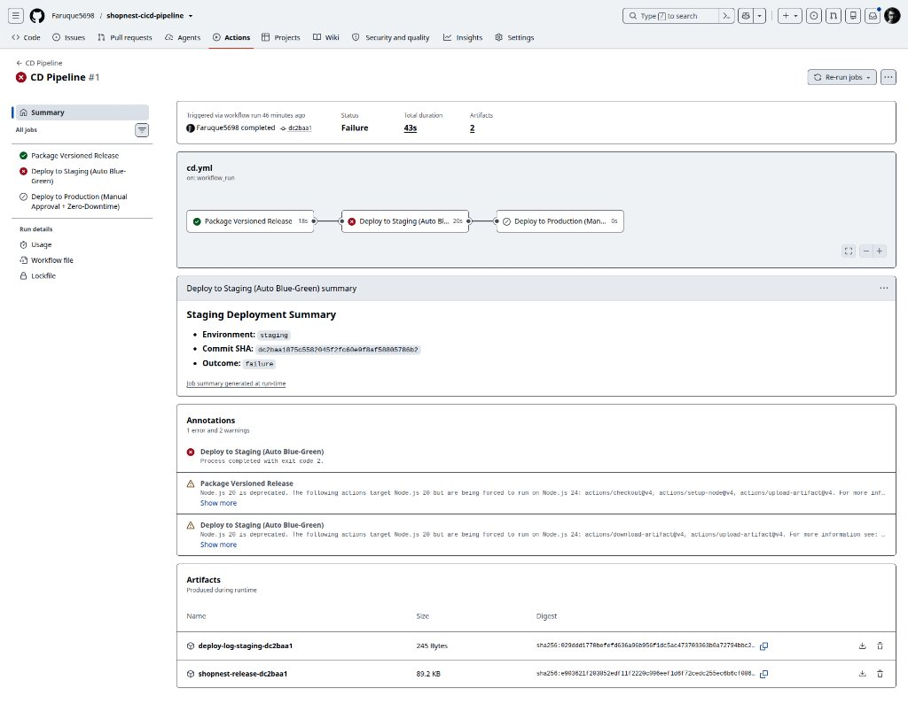

#### Failure #2: Workflow YAML Syntax Error (`CI Pipeline`)
- **Failed Run:** [YAML Syntax Error (`#44920473611`)](https://github.com/Faruque5698/shopnest-cicd-pipeline/actions/runs/44920473611)
- **Error Observed:**
  ```text
  Invalid workflow file: .github/workflows/ci.yml#L23
  You have an error in your yaml syntax on line 23
  ```
- **Root Cause & Copilot Troubleshooting:** Misaligned indentation placed `runs-on: ubuntu-latest` at the job-map level (`2` spaces instead of `4`), accompanied by an unclosed YAML flow sequence `[unclosed`. GitHub Copilot immediately identified the YAML nesting mismatch and unclosed bracket syntax.
- **Fix Applied:** Re-aligned `runs-on: ubuntu-latest` under `security-hygiene:` at 4-space indentation and removed the malformed unclosed sequence.
- **Fix Commit:** [`29d11e9`](https://github.com/Faruque5698/shopnest-cicd-pipeline/commit/29d11e9) ([PR #9](https://github.com/Faruque5698/shopnest-cicd-pipeline/pull/9))

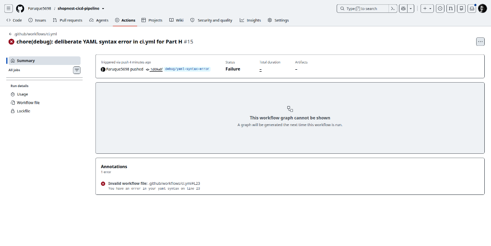

#### Failure #3: Automated Unit Test Failure & Branch Protection Block (`CI Pipeline`)
- **Failed Run:** [Backend Unit Test Failure (`#44920756752`)](https://github.com/Faruque5698/shopnest-cicd-pipeline/actions/runs/44920756752)
- **Error Observed:**
  - Both `Backend CI (Node.js 20)` and `Backend CI (Node.js 22)` matrix jobs failed in `calculateOrderTotals` (`expected { subtotal: 100, tax: 5, total: 105 }, received { subtotal: 100, tax: 15, total: 115 }`).
  - Attempting to merge PR #10 was rejected by GitHub Branch Protection:
    `Pull request Faruque5698/shopnest-cicd-pipeline#10 is not mergeable: the base branch policy prohibits the merge.`
- **Root Cause & Copilot Troubleshooting:** GitHub Copilot noted that identical failures across both Node.js 20 and Node.js 22 ruled out a runtime compatibility issue and pointed directly to a business-logic regression in `calculateOrderTotals()` (`0.15` tax rate instead of `0.05`).
- **Fix Applied:** Restored the 5% sales tax rate (`subtotal * 0.05`) in [`backend/src/app.js`](backend/src/app.js); CI passed all 5 checks and PR #10 merged cleanly.
- **Fix Commit:** [`dfe6f66`](https://github.com/Faruque5698/shopnest-cicd-pipeline/commit/dfe6f66) ([PR #10](https://github.com/Faruque5698/shopnest-cicd-pipeline/pull/10))

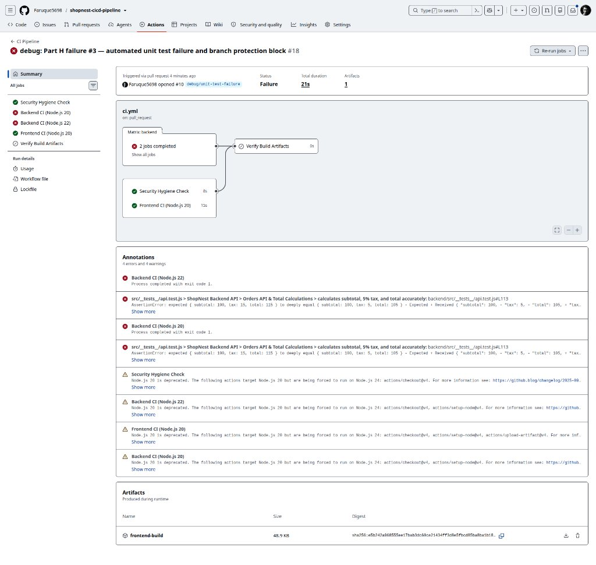

---

## 10. Part I: Repository Structure & Reproducible Setup Guide

### Folder Structure
```text
shopnest-cicd-pipeline/
├── .github/workflows/
│   ├── ci.yml                  # Continuous Integration (parallel, Node 20/22 matrix, artifacts)
│   ├── cd.yml                  # Continuous Delivery (workflow_run -> Staging -> Approval -> Prod)
│   └── rollback.yml            # Manual Zero-Downtime Rollback to any earlier commit SHA
├── backend/                    # Application Tier (Express REST API, ESLint, 9 Vitest tests, build)
│   ├── .env.example
│   ├── eslint.config.js
│   ├── package.json
│   ├── scripts/build.js
│   └── src/
│       ├── app.js
│       ├── server.js
│       ├── config/db.js
│       └── __tests__/api.test.js
├── frontend/                   # Presentation Tier (React + Vite, ESLint, 6 Vitest + RTL tests)
│   ├── .env.example
│   ├── eslint.config.js
│   ├── package.json
│   ├── vite.config.js
│   └── src/
│       ├── App.jsx
│       ├── App.css
│       ├── utils/cart.js
│       └── __tests__/
├── database/                   # Data Tier (PostgreSQL schema & idempotent seed)
│   ├── schema.sql
│   └── seed.sql
├── scripts/
│   ├── setup-ec2.sh            # One-command Ubuntu EC2 provisioning (Node, Nginx, PM2, psql)
│   ├── deploy-blue-green.sh    # Blue-Green cutover, pre/post health checks & auto-rollback
│   └── zero-downtime-test.sh   # Continuous HTTP availability proof script
└── docs/
    ├── zero-downtime-evidence.txt
    └── screenshots/            # Evidence screenshots referenced throughout this README
```

### Step-by-Step Reproducible Setup

#### 1. Local Development & Testing
```bash
git clone https://github.com/Faruque5698/shopnest-cicd-pipeline.git
cd shopnest-cicd-pipeline

# Backend lint, tests & build
cd backend && npm ci && npm run lint && npm test && npm run build

# Frontend lint, tests & build
cd ../frontend && npm ci && npm run lint && npm test && npm run build
```

#### 2. Provision AWS Three-Tier Infrastructure
1. **Create Custom VPC (`10.0.0.0/16`):** 2 Public Subnets + 2 Private Subnets across 2 AZs, with Internet Gateway.
2. **Create Security Groups:**
   - `shopnest-app-sg`: Inbound TCP `22`, `80`, `8080` from `0.0.0.0/0`.
   - `shopnest-db-sg`: Inbound TCP `5432` **only** from `shopnest-app-sg`.
3. **Launch EC2 (`shopnest-ec2`):** Ubuntu LTS (`t3.micro`, 15 GiB gp3) in a Public Subnet with `Auto-assign public IP: Enable`, attached to `shopnest-app-sg`.
4. **Create Private RDS PostgreSQL (`shopnest-db`):** Place in a DB Subnet Group containing **only** the 2 Private Subnets, **`Public access: No`**, attached to `shopnest-db-sg`, initial database `shopnest_prod`.
5. **Bootstrap EC2 (one command):**
   ```bash
   scp -i <KEY.pem> scripts/setup-ec2.sh ubuntu@<EC2_IP>:~/setup-ec2.sh
   ssh -i <KEY.pem> ubuntu@<EC2_IP> "bash ~/setup-ec2.sh"
   ```
6. **Create Staging Database from inside EC2:**
   ```bash
   PGSSLMODE=require psql -h <RDS_ENDPOINT> -p 5432 -U shopnest_admin -d shopnest_prod -c "CREATE DATABASE shopnest_staging;"
   ```

#### 3. Configure GitHub Repository Protection & Environments
1. **Branch Protection (`Settings → Branches → main`):** Require Pull Requests, require all 5 CI status checks (`Security Hygiene Check`, `Backend CI (Node.js 20)`, `Backend CI (Node.js 22)`, `Frontend CI (Node.js 20)`, `Verify Build Artifacts`), and enable `Do not allow bypassing the above settings`.
2. **Environments (`Settings → Environments`):**
   - Create `staging` and `production`.
   - On `production`, enable **Required reviewers** and add your maintainer account.
   - Add all 6 Secrets and 9 Variables listed in [Part D](#5-part-d-secrets-and-configuration-management) to each environment.
3. Open a Pull Request into `main` → CI verifies code → merge → `CD Pipeline` automatically deploys to Staging → approve Production → Blue-Green zero-downtime rollout goes live!
